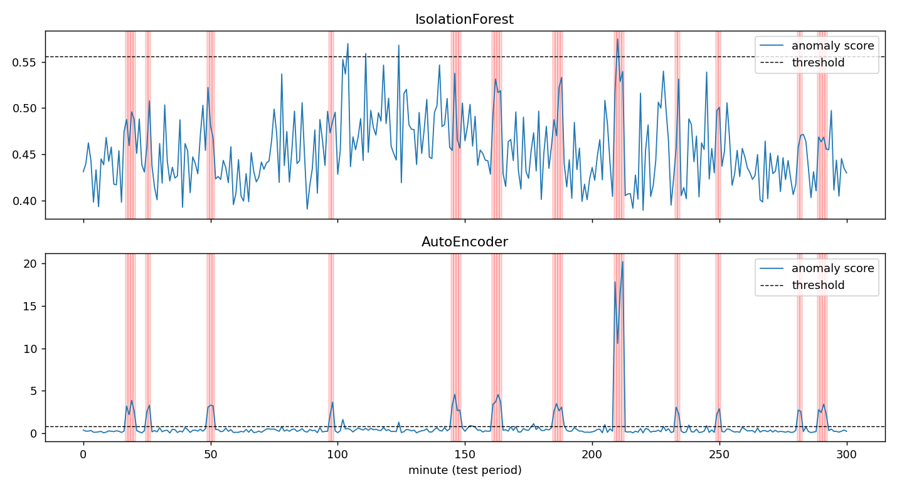

# Log Anomaly Detection


An unsupervised pipeline that detects abnormal behaviour in server logs using
**Isolation Forest** and an **Autoencoder**. It turns raw log lines into
time-window feature vectors, learns what "normal" looks like, and flags windows
that deviate from it.



## How it works

```
raw logs -> parsing -> template extraction -> 1-minute windows -> feature vectors -> model -> anomaly score
```

1. **Parsing & template extraction**: numbers and IPs are masked (`<NUM>`, `<IP>`), so
   `Request GET /users/42 completed in 120ms` and `.../users/97 ... 85ms` collapse into one template.
2. **Window features**: per 1-minute window, the count of every known template, plus
   `unknown_count` (templates never seen in training), total events, ERROR ratio and WARN ratio.
3. **Training on normal data only**: the first half of the timeline is the baseline.
   Vocabulary and scalers are fit on it alone, so there is no data leakage.
4. **Detection**: the threshold is the 99th percentile of anomaly scores on the training windows.

Injected anomalies (second half of the timeline): a database-timeout error burst,
a brute-force login attack, and a previously unseen out-of-memory pattern.

## Results (synthetic data: 600 minutes, ~78k log lines)

| Model | ROC-AUC | Precision (anomaly) | Recall (anomaly) |
|---|---|---|---|
| Isolation Forest | 0.83 | 0.25 | 0.03 |
| Autoencoder | **1.00** | **0.80** | **1.00** |

**Why does Isolation Forest struggle here?** All three anomalies produce templates never seen in
training, so they land in the `unknown_count` feature. That feature is constant (always 0) in the
training data, and tree-based isolation can only split inside the range it has seen, so it cannot
extrapolate to it. The Autoencoder reconstructs every feature and therefore produces a large error as
soon as one of them leaves its normal range.

> Results on synthetic data are optimistic. Treat them as a sanity check of the pipeline, not as a
> benchmark. See *Roadmap* for evaluation on real datasets.

## Quick start

```bash
git clone https://github.com/<your-username>/log-anomaly-detection.git
cd log-anomaly-detection
python -m venv .venv && source .venv/bin/activate   # Windows: .venv\Scripts\activate
pip install -r requirements.txt

python main.py                       # generate synthetic logs, train, evaluate, save plot
python main.py --log path/to/app.log # run on your own log file (scores + plot only)
```

Prefer a notebook? Everything is also in a single file:
[`notebooks/log_anomaly_detection.ipynb`](notebooks/log_anomaly_detection.ipynb).

Expected log line format (change the regex in `src/parse_logs.py` for other formats):

```
2026-10-01 12:00:01,123 INFO [api] Request GET /users/42 completed in 120ms
```

Run the tests:

```bash
pip install -r requirements-dev.txt
pytest
```

## Project structure

```
.
├── main.py                  # end-to-end pipeline (CLI)
├── src/
│   ├── generate_logs.py     # synthetic log generator + anomaly injection
│   ├── parse_logs.py        # parsing and template extraction
│   ├── features.py          # window features and labels
│   └── models.py            # IsolationForest and Autoencoder detectors
├── notebooks/
│   └── log_anomaly_detection.ipynb   # the whole project in one notebook
├── tests/                   # pytest smoke and unit tests
├── docs/scores.png          # result figure
└── .github/workflows/ci.yml # CI: runs tests on every push
```

## Roadmap

- [ ] Replace regex masking with the **Drain** algorithm (`drain3`)
- [ ] Evaluate on real datasets: **HDFS** and **BGL** from [Loghub](https://github.com/logpai/loghub)
- [ ] Sequence model (**LSTM / DeepLog**) for next-event prediction
- [ ] Sliding windows instead of fixed, non-overlapping ones
- [ ] Alerting API (FastAPI) and Grafana dashboard

## License

MIT, see [LICENSE](LICENSE).
